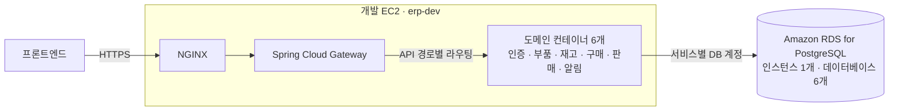

# 현대파츠 ERP 인프라

자동차 부품 ERP의 API Gateway, 개발 서버 구성과 Jenkins 공통 파이프라인을 관리한다. 여섯 도메인은 각각의 저장소에서 개발하고, 개발 서버에서는 동일한 HTTPS 주소를 통해 API를 제공하도록 구성했다.

## 개발 환경 아키텍처

예를 들어 부품 목록 요청인 `GET /api/v1/items`는 NGINX에서 HTTPS 연결을 처리한 뒤 Gateway로 전달된다. Gateway는 요청 경로에 따라 `erp-item:8082`로 전달하며, 브라우저의 교차 출처 요청(CORS)도 여기서 관리한다. 개발 환경에서는 서비스마다 컨테이너와 데이터베이스를 분리하고, EC2와 RDS 인스턴스는 공유한다. [Gateway 라우팅](api-gateway/src/main/resources/application.yml) · [개발 서버 Compose](compose.dev.yaml)

## 빌드와 배포

- **도메인 CI** — Jenkins가 임시 PostgreSQL을 준비하고 해당 저장소의 Gradle 테스트와 빌드를 실행한다. 여섯 저장소가 같은 파이프라인을 사용한다. [공통 파이프라인](vars/erpService.groovy)
- **개발 서버 CD** — `main` 빌드가 성공하고 배포 대상이 설정돼 있으면 이미지를 Amazon ECR에 올린다. Jenkins가 AWS Systems Manager로 배포를 요청하면 EC2는 해당 도메인 컨테이너만 교체한다. [배포 요청](resources/erp/deploy-dev.sh)
- **배포 확인** — 새 컨테이너의 헬스체크가 `UP`이면 이미지 버전을 기록한다. 실패하면 직전 이미지가 있는 경우 해당 이미지로 복구를 시도한다. [배포 스크립트](deploy/deploy-service.sh)

## 로컬 개발

로컬 Compose는 Gateway와 PostgreSQL을 제공한다. 담당 도메인 앱은 각 저장소에서 실행하고, 통합 요청은 로컬 Gateway(`localhost:8080`)로 보낸다. [로컬 Compose](compose.yaml)

팀원별 실행 방법과 개발 서버 기동 순서는 [인프라 운영 가이드](https://app.notion.com/p/4246da9ae26a8155865dc26bada91738)에 정리했다.
